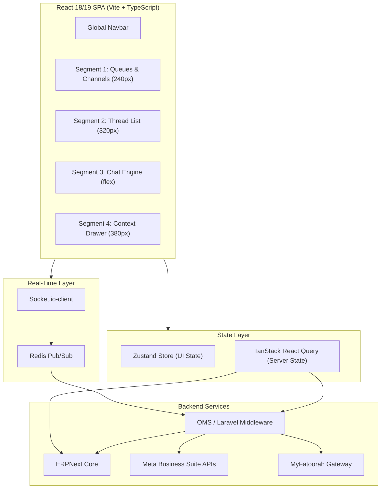
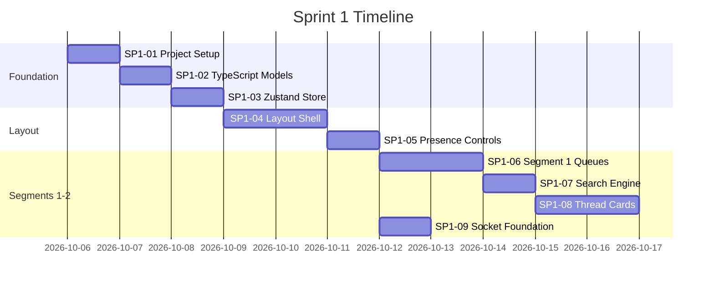
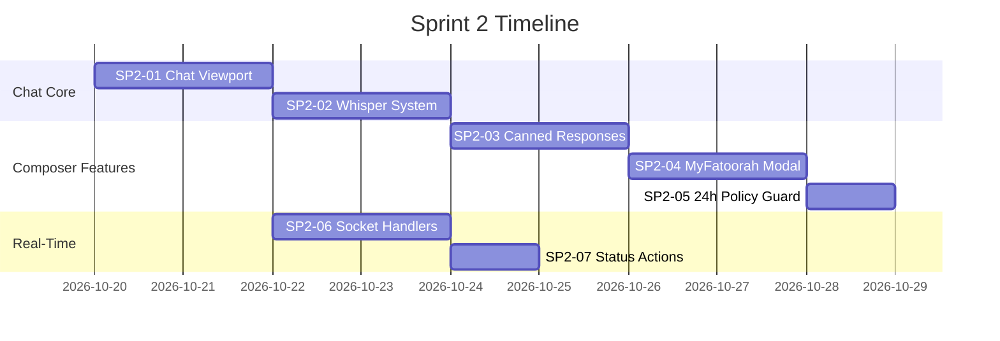
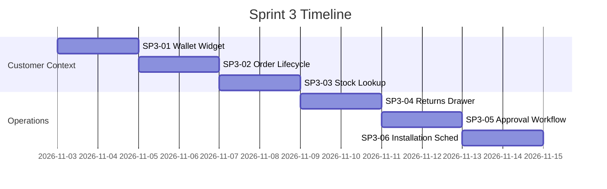
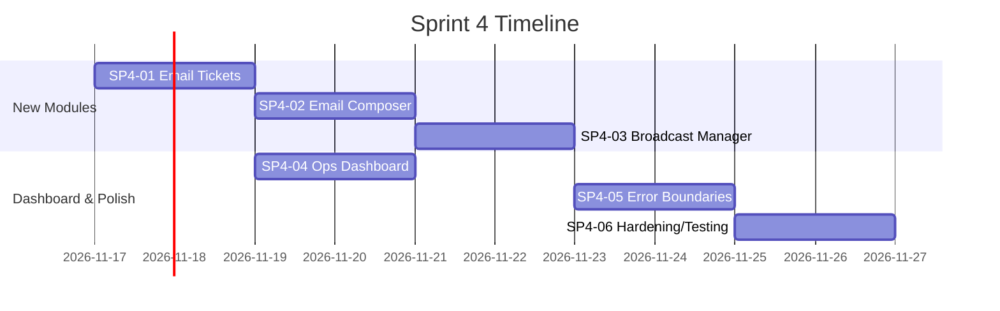

# Halamama Integrated Customer Care Platform — Implementation Plan

> **Project**: Front-End SPA for Halamama's omni-channel customer care operations
> **Stack**: React 18/19 · TypeScript · Vite · Tailwind CSS · Zustand · TanStack Query · Socket.io-client
> **Timeline**: 4 Sprints × 2 Weeks = **8 Weeks Total**
> **Workspace**: `c:\laragon\www\projects\HM-Customer-Care`

---

## Table of Contents

- [Architecture Overview](#architecture-overview)
- [Sprint 1 — Application Shell, Layout & State Foundation](#sprint-1)
- [Sprint 2 — Conversational Desk, Whispers & Meta Workflows](#sprint-2)
- [Sprint 3 — Customer 360, ERP/OMS Drawer & Operations](#sprint-3)
- [Sprint 4 — Email Tickets, Broadcasts, Dashboards & Hardening](#sprint-4)
- [Directory Structure](#directory-structure)
- [API Contracts Summary](#api-contracts)
- [Socket.io Event Map](#socket-events)
- [Sign-Off Checklist](#sign-off-checklist)

---

## Architecture Overview



### Layout Grid

| Segment | Purpose | Width | Behavior |
|---------|---------|-------|----------|
| **1** | Channel Queues, Department Filters, Tags | `240px` | Collapsible to `64px` icon rail |
| **2** | Conversation Thread List + Search | `320px` | Fixed |
| **3** | Chat Engine, Composer & Action Desk | `flex (min 520px)` | Expands to fill |
| **4** | Customer 360, Orders, Returns, OMS Slots | `380px` | Collapsible drawer |

---

<a id="sprint-1"></a>
## Sprint 1 — Application Shell, Layout & State Foundation
**Duration**: Weeks 1–2 (10 working days)
**Goal**: Scaffold the entire app, establish the grid, configure state management, and build Segments 1 & 2.

### Task Breakdown

| Task ID | Component | Description | Acceptance Criteria | Days |
|---------|-----------|-------------|---------------------|------|
| **SP1-01** | Project Setup & Tooling | Initialize `Vite + React + TypeScript` with Tailwind CSS, clsx, tailwind-merge, lucide-react. Set up `apiClient.ts` with bearer token interceptors. Create `.env.example` with `VITE_API_BASE_URL` and `VITE_WS_ENDPOINT`. | Clean `pnpm build` with zero lint/type warnings. HTTP client configured with auth interceptors. | 1.0 |
| **SP1-02** | TypeScript Domain Models | Define all core interfaces in `src/types/care.ts`: `ChannelType`, `TicketStatus`, `DepartmentType`, `UserProfile`, `CustomerContext`, `SalesOrderSummary`, `OrderItem`, `ChatMessage`, `ReturnRequestPayload`. | Complete type safety — zero `any` declarations in production interfaces. | 0.5 |
| **SP1-03** | Zustand Global Store | Build `src/store/useCareStore.ts` managing: `activeTab`, `activeDepartment`, `activeStatusFilter`, `sharedTeamView`, `selectedThreadId`, `activeCustomer`, `activeOrders`, messages map, and all setter actions. | Store handles state mutations and cross-segment filter switching deterministically. | 1.0 |
| **SP1-04** | Global Layout Shell | Create `MainShell.tsx` (100vh, 4-column CSS grid: `240px 320px 1fr 380px`) and `GlobalNavbar.tsx` with view switcher tabs: Live Care, Tickets, Dashboard, Broadcasts. Environment badge (Production/Staging). | No horizontal scrolling. Responsive across 1080p and 1440p displays. | 1.5 |
| **SP1-05** | Agent Presence & Team Controls | Build presence dropdown (Online, Busy/On Break, Offline) and "View All Team Chats" toggle in `GlobalNavbar.tsx`. | Status changes update Zustand store and emit socket presence events. | 0.5 |
| **SP1-06** | Segment 1: Channels & Queues | Build `ChannelFilterList.tsx` (WhatsApp/Instagram/Messenger pill counts), `DepartmentSelector.tsx` (General, Returns, Operations, Installation, Sales), `TagFilterGroup.tsx` (In Progress, Pending, Follow Up, Resolved). | Clicking any filter triggers immediate re-filtering in the store. Collapsible to icon rail at 64px. | 1.5 |
| **SP1-07** | Segment 2: Search Engine | Build `ThreadSearchBar.tsx` with `useDebounce.ts` hook (300ms). Search across customer name, phone, order ID. | Filters conversation list without unnecessary re-renders. | 1.0 |
| **SP1-08** | Segment 2: Thread Cards | Build `ThreadCard.tsx` and `ThreadList.tsx`. Render channel icon badges, unread counter, last message snippet, relative timestamp, color-coded tag pills, SLA countdown indicator dot. | Correctly highlights selection state. Incoming unread triggers sound alert. Auto-scrolls to new threads. | 2.0 |
| **SP1-09** | Socket.io Foundation | Implement `src/services/socket.ts` and `hooks/useSocketSubscription.ts`. Token-based auth handshake, reconnection fallbacks, and connection lifecycle management. | App establishes and maintains real-time connection. Reconnects gracefully on network drops. | 1.0 |

### Sprint 1 Implementation Steps



#### Step-by-Step Implementation Details

**SP1-01: Project Scaffolding**
```bash
# Initialize Vite project
cd c:\laragon\www\projects\HM-Customer-Care
npx -y create-vite@latest ./ --template react-ts

# Install dependencies
pnpm add zustand @tanstack/react-query axios socket.io-client lucide-react date-fns tailwind-merge clsx react-dropzone
pnpm add -D tailwindcss@3 postcss autoprefixer @types/react @types/react-dom

# Initialize Tailwind
npx tailwindcss init -p
```

Key configuration files to create:
- `tailwind.config.js` — custom colors (Halamama brand palette), screen breakpoints
- `.env.example` — `VITE_API_BASE_URL`, `VITE_WS_ENDPOINT`
- `src/api/apiClient.ts` — Axios instance with bearer token interceptor, response/error interceptors
- `tsconfig.json` — strict mode enabled, path aliases (`@/` → `src/`)

**SP1-02: TypeScript Domain Models**

Create `src/types/care.ts` with exact interfaces from the specification:
- `ChannelType` = `'whatsapp' | 'instagram' | 'messenger' | 'email'`
- `TicketStatus` = `'in_progress' | 'pending' | 'follow_up' | 'resolved'`
- `DepartmentType` = `'general' | 'returns' | 'operations' | 'installation' | 'sales'`
- Full interfaces: `UserProfile`, `CustomerContext`, `SalesOrderSummary`, `OrderItem`, `ChatMessage`, `ReturnRequestPayload`

Also create `src/types/erpnext.ts` for ERPNext-specific types (stock balances, wallet ledger entries).

**SP1-03: Zustand Store**

Build `src/store/useCareStore.ts` — the central UI state store. This store manages:
- View navigation (`activeTab`)
- Filter state (`activeDepartment`, `activeStatusFilter`)
- Team visibility toggle (`sharedTeamView`)
- Selected conversation (`selectedThreadId`)
- Active customer context (`activeCustomer`, `activeOrders`)
- Message cache (`messages: Record<string, ChatMessage[]>`)

> [!IMPORTANT]
> State management is **strictly decoupled**: Zustand for UI/transient state, TanStack React Query for server-fetched data (orders, stock, tickets). Never mix API cache into Zustand.

**SP1-04: Layout Shell**

`MainShell.tsx` uses CSS Grid:
```css
.care-layout {
  display: grid;
  grid-template-columns: 240px 320px 1fr 380px;
  grid-template-rows: 56px 1fr;
  height: 100vh;
  overflow: hidden;
}
```

`GlobalNavbar.tsx` spans all columns at row 1. Contains:
- Brand logo + environment badge
- View switcher tabs (Live Care | Tickets | Dashboard | Broadcasts)
- Global search (optional, Sprint 4)
- Agent presence dropdown
- Team/Group context selector
- Agent profile avatar

**SP1-06: Segment 1 Components**

Three sub-components stacked vertically:
1. `ChannelFilterList.tsx` — WhatsApp (14), Instagram (6), Messenger (2) with live counts from socket events
2. `DepartmentSelector.tsx` — Radio-style list: General, Returns & Replacements, Operations, Installation, VIP
3. `TagFilterGroup.tsx` — Checkbox filters with color-coded badges: In Progress (blue), Pending (amber), Follow Up (purple), Resolved (green)

**SP1-08: Thread Cards**

`ThreadCard.tsx` renders:
- Channel badge icon (WhatsApp green, Instagram gradient, Messenger blue)
- Customer name + last message snippet (truncated to 2 lines)
- Relative timestamp (date-fns `formatDistanceToNow`)
- Tag pill with color coding
- Department label
- Unread count badge (red dot)
- SLA countdown indicator (green → amber → red as time runs out)
- Bot Active badge when automated flow is handling the customer

States: default, selected (highlighted border), unread (bold text + badge), SLA-breached (red pulse animation)

---

<a id="sprint-2"></a>
## Sprint 2 — Conversational Desk, Whispers & Meta Workflows
**Duration**: Weeks 3–4 (10 working days)
**Goal**: Build Segment 3 — the real-time chat engine, internal notes system, canned responses, payment link generation, and Meta's 24-hour policy enforcement.

### Task Breakdown

| Task ID | Component | Description | Acceptance Criteria | Days |
|---------|-----------|-------------|---------------------|------|
| **SP2-01** | Chat Viewport & Bubbles | Build `ChatMessageBubble.tsx` and scrollable message list. Handle 4 sender types: customer (left-aligned), agent (right-aligned), bot (left, system style), internal_note (full-width amber card). Delivery checkmarks (✓✓). | Smooth auto-scroll on new messages. Supports text, images, voice notes, documents. | 2.0 |
| **SP2-02** | Internal Whisper Tab System | Build `InternalNoteComposer.tsx` with dual-tab composer: "WhatsApp Message" vs "Internal Whisper Note". Whisper notes styled amber-yellow background. | Internal notes clearly differentiated. **Cannot** be accidentally sent to Meta APIs. | 1.5 |
| **SP2-03** | Canned Response Menu | Build `CannedResponsePicker.tsx`. Typing `/` triggers popover with canned snippets (`/store_loc`, `/delivery_policy`, `/bank_details`, `/return_faq`). | Keyboard navigation (↑↓ + Enter) inserts text into active composer. Popover dismisses on Escape. | 1.5 |
| **SP2-04** | MyFatoorah Payment Generator | Build `MyFatoorahModal.tsx` + `api/paymentApi.ts`. Form: Amount (QAR), Phone (pre-filled), Order reference dropdown. Calls `POST /api/v1/care/payments/generate-link`. | Successful generation returns short URL and inserts rich payment card into chat. | 1.5 |
| **SP2-05** | 24-Hour Policy Lockout | Guard checking `last_customer_message_timestamp`. If > 24 hours → lock freeform input, show `[Send Meta Approved Template (HSM)]` button. | Strictly prevents unauthorized outbound messages past Meta's 24-hour window. | 1.0 |
| **SP2-06** | Real-Time Event Handlers | Bind `chat:inbound_message` and `chat:thread_reassigned` socket events. Update messages array and thread previews dynamically. | Messages appear instantly without reload. Incoming message audio alert plays. | 1.5 |
| **SP2-07** | Thread Status & Reassignment | Build `ChatHeader.tsx` with: Tag selector dropdown, Department reassignment modal, "Mark as Resolved" one-click action. | Reassignment updates local UI and emits socket broadcast to move thread across department queues. | 1.0 |

### Sprint 2 Implementation Steps



#### Step-by-Step Implementation Details

**SP2-01: Chat Viewport**

`ChatMessageBubble.tsx` — polymorphic bubble component handling all 4 sender types:

| Sender Type | Alignment | Style |
|-------------|-----------|-------|
| `customer` | Left | Light gray bg, rounded-r corners |
| `agent` | Right | Brand blue/green bg, white text, rounded-l corners |
| `bot` | Left | System gray, italic, bot icon |
| `internal_note` | Full-width | Amber-yellow bg, lock icon, "Internal Only" label |

Each bubble shows:
- Sender name + timestamp
- Message text with link detection
- Media preview (images → thumbnail, docs → file icon + name)
- Payment link card (if `payment_link_metadata` present)
- Delivery status indicators: ✓ sent, ✓✓ delivered (gray), ✓✓ read (blue)

Message list uses `useRef` + `scrollIntoView({ behavior: 'smooth' })` to auto-scroll to latest message on new arrivals.

**SP2-02: Dual-Tab Composer**

The `ComposerBar.tsx` component renders two tabs:
1. **WhatsApp Message** — standard outbound to customer via Meta Cloud API
2. **Internal Whisper Note** — amber-tinted, stored internally, visible only to support/management

> [!CAUTION]
> Internal whisper notes must **never** be dispatched through Meta APIs. The tab switch must toggle the API endpoint used on send. Add a visual "INTERNAL ONLY" watermark label when whisper mode is active.

**SP2-03: Canned Response Quick Menu**

When user types `/` at the start of a line or after a space:
1. Popover menu appears anchored to cursor position
2. Shows filterable list of canned responses
3. Keyboard navigation: ↑/↓ to select, Enter to insert, Escape to dismiss
4. After selection, `/command` text is replaced with the full canned response

Example entries:
- `/store_loc` → "Our showroom is at..."
- `/delivery_policy` → "We offer free delivery for orders above QAR 200..."
- `/bank_details` → "Bank: QNB | Account: ..."
- `/return_faq` → "You can initiate a return within 7 days..."

**SP2-04: MyFatoorah Payment Link Generator**

Modal form fields:
- Amount (QAR) — number input with currency formatting
- Customer Phone/Email — pre-populated from active thread's customer context
- Reference Document — dropdown of open Sales Orders / Invoices

On submit → `POST /api/v1/care/payments/generate-link` → on success, insert a rich payment card into the chat:
```
┌──────────────────────────────┐
│  💳 Payment Request          │
│  Amount: QAR 450.00          │
│  Ref: SO-2026-0881           │
│  [Pay Now →]                 │
│  Expires: 24 hours           │
└──────────────────────────────┘
```

**SP2-05: 24-Hour Policy Guard**

Logic in `ComposerBar.tsx`:
```typescript
const lastCustomerMsg = messages.filter(m => m.sender_type === 'customer').at(-1);
const isWithin24h = lastCustomerMsg && differenceInHours(new Date(), new Date(lastCustomerMsg.created_at)) < 24;

if (!isWithin24h) {
  // Disable freeform text input
  // Show: [Send Meta Approved Template (HSM)] button
}
```

---

<a id="sprint-3"></a>
## Sprint 3 — Customer 360, ERP/OMS Drawer & Operations
**Duration**: Weeks 5–6 (10 working days)
**Goal**: Build Segment 4 — the context drawer integrating ERPNext wallet, order tracking, returns with threshold approval, and OMS installation scheduling.

### Task Breakdown

| Task ID | Component | Description | Acceptance Criteria | Days |
|---------|-----------|-------------|---------------------|------|
| **SP3-01** | Customer 360 & Wallet | Build `CustomerWalletCard.tsx`. Customer profile, lifetime spend, order count, real-time ERPNext wallet balance. Actions: Credit / Debit modals. | Wallet balance accurate. Credit/Debit modal triggers ledger mutations. | 1.5 |
| **SP3-02** | OMS Order Lifecycle | Build `OrderHistoryAccordion.tsx`. Collapsible order cards with delivery step tracker: Picked → Packed → In Transit → Out for Delivery → Delivered. | Shows driver name, vehicle #, live status. Updates via `oms:delivery_status_changed`. | 1.5 |
| **SP3-03** | Live Catalog Stock Lookup | Build `ERPStockLookup.tsx` + `api/catalogApi.ts`. Searchable by Item Code or Name. Display warehouse balances (Bay WH, Main WH, Transit). | Sub-second stock checks. Results formatted as a compact table. | 1.5 |
| **SP3-04** | Returns & Replacements | Build `ReturnApprovalDrawer.tsx` + `api/returnsApi.ts`. Multi-select items, quantities, return reason, resolution type. Calls `POST /api/v1/care/returns/create`. | Correctly calculates total. Sets `requires_approval = true` if total > QAR 200. | 2.0 |
| **SP3-05** | Management Approval Workflow | Conditional approval banner. If return > QAR 200 → require `operations_manager` role to Approve/Reject. | Non-manager agents see "Pending Approval" badge. Managers see Approve/Reject buttons. | 1.5 |
| **SP3-06** | OMS Installation Scheduler | Build `InstallationSchedulerModal.tsx` + `api/installationApi.ts`. Calendar picker + slot selector by Delivery Zone. Calls `POST /api/v1/oms/installation/schedule`. | Submission locks slot, updates OMS, shows confirmation reference. | 2.0 |

### Sprint 3 Implementation Steps



#### Step-by-Step Implementation Details

**SP3-01: Customer 360 & Wallet Widget**

`CustomerWalletCard.tsx` layout:
```
┌─ Customer Profile ──────────────┐
│  👤 Fatima Al-Kuwari             │
│  📱 +974 5512 3456               │
│  🏷️ Retail Customer              │
│  📦 6 Lifetime Orders            │
│                                  │
│  ┌─ Store Credit ─────────────┐  │
│  │  💰 QAR 250.00             │  │
│  │  [+ Credit]  [- Deduct]    │  │
│  └────────────────────────────┘  │
└──────────────────────────────────┘
```

Uses TanStack Query to fetch wallet balance from ERPNext with a `staleTime` of 30 seconds. Credit/Debit opens a modal with amount input and note field.

**SP3-02: Order Lifecycle Tracker**

`OrderHistoryAccordion.tsx` — collapsible accordion for each active order:

```
▼ SO-2026-0881 | QAR 1,850.00 | 01 Oct 2026
  ──●──●──●──◐──○──
  Picked  Packed  Transit  Out for Delivery  Delivered

  🚚 Driver: Naseef (Vehicle #12)
  📍 [Live GPS Tracker]

  Items:
  • 1x Wooden Dining Table 6-Seater
  • 6x Upholstered Dining Chairs (FUR-CHR-01)

  [View Full Order]  [Download Invoice]  [Create Ticket]
```

Real-time updates via `oms:delivery_status_changed` socket event.

**SP3-04: Returns & Replacements**

Form workflow:
1. Select Order (dropdown of customer's recent orders)
2. Multi-select items from that order with return quantities
3. Select return reason: Damaged | Wrong Item | Customer Cancellation
4. Select resolution: Wallet Credit | Item Replacement | Gateway Refund
5. System auto-calculates `total_refund_amount`

> [!IMPORTANT]
> **Threshold Logic**: If `total_refund_amount ≤ QAR 200` → Auto-Approved (create ERPNext return receipt immediately). If `> QAR 200` → set `requires_approval = true`, dispatch to Operations Manager via socket event `returns:approval_required`.

**SP3-05: Management Approval Banner**

For users with `role === 'operations_manager'`, render an action banner:
```
⚠️ Management Action Required: Return #RET-4091 (QAR 450.00)
   Initiated by: Support Agent | Reason: Damaged Goods
   [ Reject ]   [ Approve Return & Issue Credit ]
```

For regular agents, show a read-only status: `🔒 Pending Operations Manager Approval`

**SP3-06: Installation Slot Scheduler**

Trigger condition: Any item in the order has `requires_installation === true` in ERPNext Item Master.

Modal UI:
1. Delivery Zone selector (fetched from OMS API)
2. Calendar date picker (disabled past dates, disabled fully-booked dates)
3. Available time slots for selected date/zone (e.g., 09:00–12:00, 12:00–15:00, 15:00–18:00)
4. Shows assigned installation team name and lead
5. "Book Installation Slot" button → `POST /api/v1/oms/installation/schedule`

---

<a id="sprint-4"></a>
## Sprint 4 — Email Tickets, Broadcasts, Dashboards & Hardening
**Duration**: Weeks 7–8 (10 working days)
**Goal**: Build Email Ticket Desk, WhatsApp Broadcast manager, Operations Dashboard, error handling, and production hardening.

### Task Breakdown

| Task ID | Component | Description | Acceptance Criteria | Days |
|---------|-----------|-------------|---------------------|------|
| **SP4-01** | Email Ticket Table | Build `tickets/TicketTable.tsx`. Columns: Ticket ID, Sender, Subject, Customer Link, Priority, Status, Timestamp. | Filterable by status (Open, Pending Ops, Escalated, Closed). Pagination and search functional. | 2.0 |
| **SP4-02** | Email Thread & Composer | Build `tickets/EmailThreadViewer.tsx` + `tickets/EmailComposer.tsx`. Sanitized HTML rendering. Rich-text editor with CC/BCC and file dropzone. | Emails send through backend mail gateway. Attachments upload reliably. | 2.0 |
| **SP4-03** | WhatsApp Broadcast Manager | Build `broadcasts/BroadcastCampaignList.tsx` + `broadcasts/TemplateMessageBuilder.tsx`. Meta-approved template selector with variable mapping (`{{1}}`, `{{2}}`). | Generates valid batch campaign payload with phone lists and template params. | 1.5 |
| **SP4-04** | Operations Dashboard | Build `dashboard/ActiveTeamStats.tsx` + `dashboard/SLABreachCounter.tsx`. KPI tiles: Inbound Volume, Unassigned Pool, First Response SLA, Active Returns. | Real-time updates via socket metric events or interval polling. | 1.5 |
| **SP4-05** | Error Boundaries & Edge Cases | React error boundaries, offline banner, session timeout guards, audio notification permission handling (`useSoundAlert.ts`). | App recovers gracefully from socket disconnects and 5xx errors without unmounting layout. | 1.5 |
| **SP4-06** | E2E Hardening & Testing | Cross-browser validation (Chrome, Edge, Safari), memory leak profiling on WebSocket, production bundle optimization. | Bundle < 450KB gzipped. Zero memory leaks after 500+ socket events. | 1.5 |

### Sprint 4 Implementation Steps



#### Step-by-Step Implementation Details

**SP4-01: Email Ticket Table**

Split-pane layout for the Tickets tab:
- **Left pane** (40%): Ticket table with sortable columns, search bar, status filter pills
- **Right pane** (60%): Selected email thread viewer

Table columns:
| Ticket ID | Sender | Subject | Customer Link | Priority | Status | Timestamp |
|-----------|--------|---------|---------------|----------|--------|-----------|
| #TCK-1098 | Tariq M. | Bulk order inquiry | Tariq Mansoor | Medium | In Progress | 10:42 AM |

Status filter pills: Open, Pending Ops, Escalated, Closed

**SP4-02: Email Thread Viewer & Composer**

`EmailThreadViewer.tsx`:
- Sanitize inbound HTML (use DOMPurify or equivalent)
- Render email chain as threaded conversation
- Show attachments as downloadable chips

`EmailComposer.tsx`:
- Rich-text editor (bold, italic, lists, links)
- To/CC/BCC fields
- File attachment dropzone (react-dropzone)
- "Send" and "Save Draft" actions

**SP4-03: WhatsApp Broadcast Manager**

Two sub-views:
1. **Campaign List** — historical campaigns with metrics (audience size, delivery rate, read rate, failures)
2. **Template Builder** — select Meta-approved template, map variables, define target audience

Audience segmentation:
- Orders > QAR 1,000
- Geographic area (Doha, Al Wakra, etc.)
- Inactive > 60 days
- Custom list upload

Rate-limiting controls to prevent Meta API throttling (max N messages/second).

**SP4-04: Operations Dashboard**

KPI tile cards with real-time counters:

```
┌──────────────┐  ┌──────────────┐  ┌──────────────┐  ┌──────────────┐
│  Active Chats │  │ SLA Breaches │  │ Returns in   │  │ Installation │
│     24        │  │     3 ⚠️      │  │  Review: 7   │  │ Backlog: 12  │
└──────────────┘  └──────────────┘  └──────────────┘  └──────────────┘
```

Below tiles: team activity feed, agent performance table, queue depth charts.

**SP4-05: Error Boundaries & Resilience**

| Scenario | Handling |
|----------|----------|
| Socket disconnect | Show "Reconnecting..." banner with pulse animation. Auto-retry with exponential backoff. |
| Server 5xx error | Toast notification with retry button. Do not unmount layout. |
| Session timeout | Modal overlay: "Your session has expired. Please log in again." |
| Audio permission denied | Gracefully degrade — show visual notification badges instead. |
| Component crash | React Error Boundary catches and renders fallback UI per segment. |

**SP4-06: Production Hardening**

- [ ] Cross-browser testing: Chrome, Edge, Safari (macOS), Firefox
- [ ] Memory leak profiling: Chrome DevTools → Performance tab → 500+ simulated socket events
- [ ] Bundle analysis: `vite-plugin-visualizer` to ensure < 450KB gzipped initial chunk
- [ ] Code splitting: Lazy-load Tickets, Dashboard, and Broadcasts tabs
- [ ] Image/asset optimization
- [ ] Console cleanup: Remove all `console.log` statements

---

<a id="directory-structure"></a>
## Directory Structure

```
src/
├── api/                        # Axios clients & endpoint mutations
│   ├── apiClient.ts            # Base Axios instance with interceptors
│   ├── catalogApi.ts           # ERPNext stock lookup endpoints
│   ├── installationApi.ts      # OMS installation scheduling
│   ├── paymentApi.ts           # MyFatoorah payment link generation
│   └── returnsApi.ts           # Return initiation & approval endpoints
├── assets/                     # Notification audio, SVGs, brand assets
│   └── sounds/
│       └── approval_alert.mp3
├── components/
│   ├── common/                 # Reusable UI primitives
│   │   ├── Badge.tsx
│   │   ├── Button.tsx
│   │   ├── Modal.tsx
│   │   └── TabGroup.tsx
│   ├── layout/
│   │   ├── GlobalNavbar.tsx    # Top navigation bar
│   │   └── MainShell.tsx       # 4-segment grid container
│   ├── livecare/               # Segmented Live Care View
│   │   ├── Segment1_Queues/
│   │   │   ├── ChannelFilterList.tsx
│   │   │   ├── DepartmentSelector.tsx
│   │   │   └── TagFilterGroup.tsx
│   │   ├── Segment2_Threads/
│   │   │   ├── ThreadCard.tsx
│   │   │   ├── ThreadList.tsx
│   │   │   └── ThreadSearchBar.tsx
│   │   ├── Segment3_Chat/
│   │   │   ├── CannedResponsePicker.tsx
│   │   │   ├── ChatHeader.tsx
│   │   │   ├── ChatMessageBubble.tsx
│   │   │   ├── ComposerBar.tsx
│   │   │   ├── InternalNoteComposer.tsx
│   │   │   └── MyFatoorahModal.tsx
│   │   └── Segment4_Context/
│   │       ├── CustomerWalletCard.tsx
│   │       ├── ERPStockLookup.tsx
│   │       ├── InstallationSchedulerModal.tsx
│   │       ├── OrderHistoryAccordion.tsx
│   │       └── ReturnApprovalDrawer.tsx
│   ├── tickets/                # Email Ticket Workspace
│   │   ├── EmailComposer.tsx
│   │   ├── EmailThreadViewer.tsx
│   │   └── TicketTable.tsx
│   ├── broadcasts/             # WhatsApp Marketing Outbound
│   │   ├── BroadcastCampaignList.tsx
│   │   └── TemplateMessageBuilder.tsx
│   └── dashboard/              # SLA & Operational Visuals
│       ├── ActiveTeamStats.tsx
│       └── SLABreachCounter.tsx
├── hooks/
│   ├── useDebounce.ts          # 300ms debounce for search
│   ├── useSocketSubscription.ts # Socket event binding with cleanup
│   └── useSoundAlert.ts       # Audio notification with permission handling
├── services/
│   └── socket.ts               # Socket.io client + event registration
├── store/
│   └── useCareStore.ts         # Zustand global UI state
├── types/
│   ├── care.ts                 # Core domain interfaces
│   └── erpnext.ts              # ERPNext-specific types
├── utils/
│   ├── currencyFormatter.ts    # QAR currency formatting
│   └── dateFormatter.ts        # Relative date formatting
├── App.tsx                     # Root component with view routing
├── main.tsx                    # Entry point, providers setup
└── index.css                   # Tailwind directives + global styles
```

---

<a id="api-contracts"></a>
## API Contracts Summary

### REST Endpoints

| Method | Endpoint | Purpose | Sprint |
|--------|----------|---------|--------|
| `POST` | `/api/v1/care/payments/generate-link` | Generate MyFatoorah payment link | SP2 |
| `POST` | `/api/v1/care/returns/create` | Initiate return with threshold check | SP3 |
| `POST` | `/api/v1/oms/installation/schedule` | Book installation slot via OMS | SP3 |
| `GET` | `/api/v1/erp/customers/{phone}` | Fetch customer 360 profile | SP3 |
| `GET` | `/api/v1/erp/customers/{id}/wallet` | Fetch wallet/store credit balance | SP3 |
| `POST` | `/api/v1/erp/customers/{id}/wallet/credit` | Issue wallet credit | SP3 |
| `POST` | `/api/v1/erp/customers/{id}/wallet/debit` | Deduct from wallet | SP3 |
| `GET` | `/api/v1/erp/orders/{customer_id}` | Fetch customer order history | SP3 |
| `GET` | `/api/v1/erp/stock/{item_code}` | Real-time stock balance lookup | SP3 |
| `GET` | `/api/v1/care/threads` | List conversation threads (filtered) | SP1 |
| `GET` | `/api/v1/care/threads/{id}/messages` | Fetch message history for thread | SP2 |
| `POST` | `/api/v1/care/threads/{id}/messages` | Send outbound message | SP2 |
| `POST` | `/api/v1/care/threads/{id}/notes` | Create internal whisper note | SP2 |
| `PATCH` | `/api/v1/care/threads/{id}/assign` | Reassign thread dept/agent | SP2 |
| `GET` | `/api/v1/care/tickets` | List email tickets | SP4 |
| `POST` | `/api/v1/care/tickets/{id}/reply` | Reply to email ticket | SP4 |
| `POST` | `/api/v1/care/broadcasts/send` | Dispatch WhatsApp broadcast | SP4 |
| `GET` | `/api/v1/care/dashboard/metrics` | Fetch SLA/operations metrics | SP4 |

---

<a id="socket-events"></a>
## Socket.io Event Map

### Inbound Events (Server → Client)

| Event | Payload | Action | Sprint |
|-------|---------|--------|--------|
| `chat:inbound_message` | `{ thread_id, message: ChatMessage }` | Append message to thread, update preview, play sound | SP2 |
| `chat:thread_reassigned` | `{ thread_id, department, agent_id }` | Move thread between department queues | SP2 |
| `returns:approval_required` | `{ return_id, amount, order_id, agent_name }` | Show approval banner for operations managers | SP3 |
| `returns:status_updated` | `{ return_id, status, approved_by }` | Update return status in drawer | SP3 |
| `oms:delivery_status_changed` | `{ order_id, delivery_status, driver_name }` | Update order lifecycle tracker | SP3 |
| `agent:presence_changed` | `{ agent_id, presence }` | Update team presence indicators | SP1 |
| `metrics:updated` | `{ active_chats, sla_breaches, ... }` | Update dashboard KPI tiles | SP4 |

### Outbound Events (Client → Server)

| Event | Payload | Purpose |
|-------|---------|---------|
| `agent:set_presence` | `{ presence: 'online' \| 'busy' \| 'offline' }` | Broadcast presence change |
| `chat:send_message` | `{ thread_id, text, sender_type }` | Send outbound message |
| `chat:reassign_thread` | `{ thread_id, department, agent_id }` | Reassign conversation |
| `chat:mark_resolved` | `{ thread_id }` | Mark thread as resolved |

---

<a id="sign-off-checklist"></a>
## Sign-Off Checklist

- [ ] Repository initialized with TypeScript **strict mode** enabled
- [ ] 4-Segment layout strictly conforms to viewport constraints (**no horizontal window scrolling**)
- [ ] State management strictly decoupled: **Zustand** for UI/transient state, **React Query** for server state
- [ ] Socket listeners properly cleaned up inside `useEffect` return hooks to avoid memory leaks
- [ ] Returns exceeding **QAR 200** enforce Operations Manager approval triggers
- [ ] Meta **24-hour messaging policy** restricts freeform text when conversation window expires
- [ ] Internal whisper notes strictly styled in **amber-yellow** and routed to internal endpoints only
- [ ] Email ticket desk fully handles rich text formatting, file attachments, and sanitization
- [ ] Final production build passes clean: `pnpm lint` and `pnpm build`
- [ ] Production bundle size **< 450KB** (gzipped initial chunk)
- [ ] Zero memory leaks after **500+ simulated** incoming socket events
- [ ] Cross-browser validated: **Chrome, Edge, Safari**

---

> [!TIP]
> To begin implementation, approve this plan and I'll start with **Sprint 1, Task SP1-01** — scaffolding the Vite project with all dependencies, TypeScript config, and Tailwind setup.
