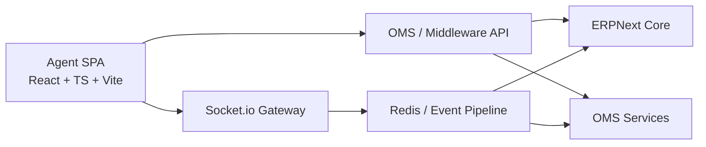
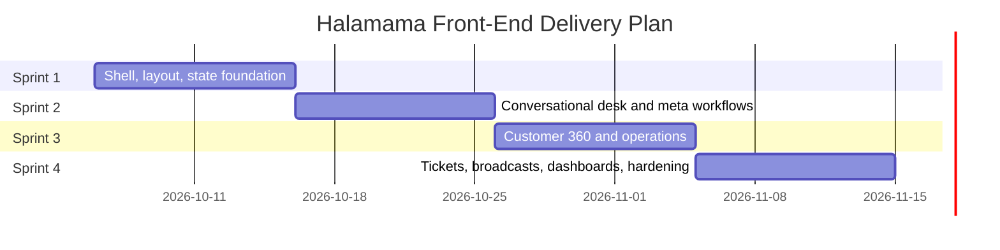

# Halamama Integrated Customer Care Platform — Front-End Implementation Plan

## Document Purpose
This document is the front-end delivery handoff for the Halamama Integrated Customer Care Platform SPA. It consolidates the architecture, layout rules, sprint plan, directory structure, API contracts, socket event map, quality gates, and sign-off criteria needed by a front-end engineer to execute the build without losing any functional or technical detail.

## Project Summary
Halamama requires a single-page customer care workspace for omni-channel operations across live chat, email tickets, broadcasts, and operational dashboards. The platform must support fast agent workflows, real-time updates, Customer 360 context, OMS and ERP-linked actions, and policy-safe communication flows.

## Core Stack
- React 18/19
- TypeScript with strict mode enabled at all times
- Vite
- Tailwind CSS
- Zustand for UI and local interaction state
- TanStack Query for server state and caching
- Socket.io-client for real-time transport

## Delivery Timeline
- 4 sprints
- 2 weeks per sprint
- Total duration: 8 weeks

## Product Scope
The SPA covers four primary operating surfaces:
- **Live Care**: Main omni-channel care desk with a four-segment layout
- **Tickets**: Email-based ticket desk and threaded resolution workflow
- **Broadcasts**: WhatsApp marketing and outbound campaign operations
- **Dashboard**: SLA, workload, operations, and performance visibility

## Mandatory Layout Specification
The live care interface uses a fixed four-segment shell:

| Segment | Purpose | Width Rule |
|---|---|---|
| Segment 1 | Channel Queue | 240px |
| Segment 2 | Thread List | 320px |
| Segment 3 | Chat Engine / Active Conversation | flex, minimum 520px |
| Segment 4 | Customer 360 / Operations Context Drawer | 380px |

### Layout Rules
- No horizontal scrolling is allowed in the primary workspace.
- The conversation area must remain the dominant visual focus.
- Secondary panels must stay readable without collapsing essential controls.
- Sticky headers and action bars should keep high-frequency actions always available.
- The shell should degrade gracefully for lower widths without breaking operator flow.

## Non-Negotiable Engineering Constraints
- TypeScript strict mode must remain enabled throughout implementation.
- Zustand handles UI state, panel state, selection state, composer state, and ephemeral workflow state.
- TanStack Query handles server state, pagination, fetching, invalidation, and mutation revalidation.
- Meta 24-hour messaging policy must be enforced in eligible message flows.
- Internal whispers must be visually distinct in amber-yellow styling and remain internal-only.
- Returns above QAR 200 require manager approval workflow enforcement.
- Production bundle target must remain under 450KB gzipped for the main app shell where feasible.
- Zero memory leaks are acceptable after 500+ socket events and repeated thread switching.
- Cross-browser support is required for Chrome, Edge, and Safari.

## High-Level Architecture
The front-end coordinates with ERPNext Core, OMS/Laravel middleware, and the real-time socket pipeline.



## Front-End Architecture Overview
The SPA should be organized around a domain-first structure with clear separation between shell, channels, threads, messages, customer context, operations, tickets, broadcasts, dashboards, and shared primitives.

### State Ownership Split
| State Type | Recommended Owner |
|---|---|
| Theme, drawer visibility, selected thread, composer draft, tab state | Zustand |
| Queue counts, threads list, thread details, customer profile, orders, tickets, broadcasts | TanStack Query |
| Transient socket event buffering and optimistic message states | Zustand with server sync hooks |
| Form validation and view-local interaction state | Component-local state where appropriate |

### Real-Time Strategy
- Keep socket subscriptions scoped to authenticated workspace context.
- Re-bind listeners on workspace changes only once.
- Normalize inbound events before state update.
- Guard against duplicate message inserts.
- Reconcile optimistic messages with server-confirmed payloads.
- Unsubscribe listeners on unmount and thread changes to prevent leaks.

## Functional Module Breakdown

### 1. Live Care Workspace
The live care workspace is the operational heart of the platform.

#### Segment 1 — Channel Queue
Must display:
- Channel filters
- Queue counts per channel
- SLA risk indicators
- Assigned vs unassigned states
- Channel health and pending volume summary

Supported channels include:
- WhatsApp
- Instagram DM
- Facebook Messenger
- Website chat
- Other live sources supported by middleware

#### Segment 2 — Thread List
Must include:
- Search
- Sorting
- Filtering by assigned agent, priority, unread, tags, and status
- Last message preview
- Customer name and avatar
- Timestamp and unread count
- SLA badge or urgency marker

#### Segment 3 — Chat Engine
Must support:
- Real-time message stream
- Text, attachment, and template messages as supported by backend
- Internal whispers
- Canned responses
- Payment link generation
- Meta-compliant messaging guardrails
- Read states and delivery states where available
- Composer state persistence during navigation
- Conversation notes and operational action prompts

#### Segment 4 — Customer 360 / Operations Context Drawer
Must include:
- Customer profile summary
- Contact and identity data
- Recent orders
- Delivery state
- Refund and return eligibility
- OMS-linked actions
- ERPNext-linked contextual information
- Risk, value, and service notes
- Approval workflow prompts for sensitive actions

### 2. Tickets Module
The tickets view manages email-originated support work.

Must support:
- Ticket inbox and status filters
- Ticket detail thread view
- Internal notes
- Assignment and escalation
- Priority and SLA indicators
- Ticket resolution actions
- Reopen and follow-up workflow

### 3. Broadcasts Module
The broadcasts view supports WhatsApp campaign operations.

Must support:
- Audience selection
- Template selection
- Campaign scheduling or sending
- Delivery and failure status visibility
- Eligibility and policy restrictions
- Broadcast history
- Reporting summary

### 4. Dashboard Module
The dashboard must expose operational and SLA reporting.

Must support:
- Queue load summaries
- Agent workload overview
- SLA breach risk
- Resolution trends
- Channel performance
- Ticket and broadcast outcome summaries

## Sprint Plan

## Sprint 1 — Application Shell, Omni-Channel Layout & State Foundation
**Goal:** Establish the application shell, foundational architecture, routing model if required by module tabs, state boundaries, and the baseline queue plus thread browsing experience.

### Sprint 1 Deliverables
- App shell and workspace scaffolding
- Four-segment live care layout
- Shared design primitives and layout components
- Zustand store setup
- TanStack Query client setup
- Authentication/session bootstrapping hooks as required by integration environment
- Channel Queue surface
- Thread List surface
- Baseline loading, empty, and error states

### Sprint 1 Work Items
| ID | Task | Estimate | Acceptance Criteria |
|---|---|---:|---|
| SP1-01 | Bootstrap React, TypeScript, Vite, Tailwind, linting, formatting, env handling | 1d | App starts cleanly with strict typing and consistent tooling |
| SP1-02 | Build global shell, top-level navigation, module tabs, and responsive frame | 2d | App shell renders stable layout with no horizontal overflow |
| SP1-03 | Implement Zustand stores and TanStack Query providers | 1d | UI state and server state are clearly separated |
| SP1-04 | Build Channel Queue with counts, filters, and status indicators | 2d | Agents can switch queues and see counts accurately |
| SP1-05 | Build Thread List with search, filters, preview cells, and unread states | 3d | Thread browsing is performant and usable at scale |
| SP1-06 | Add skeletons, empty states, and error states for shell and list views | 1d | Loading and failure states are clear and polished |

### Sprint 1 Exit Criteria
- Four-segment layout is stable.
- Queue switching works.
- Thread list rendering is performant.
- State architecture is set up correctly for later features.
- No layout-breaking overflow exists.

## Sprint 2 — Conversational Desk, Internal Whispers & Meta Workflows
**Goal:** Deliver the real-time conversation engine and all core agent interactions inside the active thread.

### Sprint 2 Deliverables
- Message timeline
- Composer and send flow
- Socket-driven updates
- Internal whispers
- Canned responses
- Payment link action flow
- Meta 24-hour policy enforcement in relevant channels
- Optimistic UI and reconciliation logic

### Sprint 2 Work Items
| ID | Task | Estimate | Acceptance Criteria |
|---|---|---:|---|
| SP2-01 | Build conversation header, message timeline, and message grouping rules | 2d | Messages render clearly with timestamps and sender distinctions |
| SP2-02 | Implement composer, attachments hooks, and message sending mutations | 2d | Agents can send messages with stable pending states |
| SP2-03 | Integrate Socket.io events for inbound and outbound conversation updates | 2d | Real-time updates arrive without duplicate inserts or leaks |
| SP2-04 | Implement internal whispers with amber-yellow treatment and internal visibility rules | 1d | Whispers are visually distinct and never shown as customer-facing |
| SP2-05 | Add canned responses and shortcut insertion workflow | 1d | Agents can insert approved canned responses quickly |
| SP2-06 | Add payment link flow and Meta policy guardrails | 2d | Restricted messaging states are handled correctly with clear UI warnings |

### Sprint 2 Exit Criteria
- Thread switching is stable.
- Messages reconcile correctly after optimistic updates.
- Whisper logic is safe and visually distinct.
- Policy constraints are enforced before send.
- Socket listeners do not accumulate on repeated navigation.

## Sprint 3 — Customer 360, ERP/OMS Drawer & Operations Integration
**Goal:** Deliver the contextual drawer and operational workflows that let agents act with complete customer and order awareness.

### Sprint 3 Deliverables
- Customer 360 drawer
- ERP and OMS-linked data panels
- Order history and fulfillment visibility
- Refund, exchange, and return workflows
- Manager approval flow for high-value returns
- Notes and contextual operational actions

### Sprint 3 Work Items
| ID | Task | Estimate | Acceptance Criteria |
|---|---|---:|---|
| SP3-01 | Build Customer 360 summary cards and profile sections | 2d | Core customer profile is visible beside the active thread |
| SP3-02 | Integrate recent orders, order detail, and fulfillment state panels | 2d | Agents can inspect order context without leaving the desk |
| SP3-03 | Add refund, replacement, and return action surfaces | 2d | Operational actions are clear and role-safe |
| SP3-04 | Enforce manager approval for returns above QAR 200 | 1d | Approval requirement appears automatically for restricted cases |
| SP3-05 | Add notes, service history, and operational context blocks | 1d | Agents can review and add context efficiently |
| SP3-06 | Harden drawer performance, caching, and refetch behavior | 2d | Context data is responsive and consistent during rapid switching |

### Sprint 3 Exit Criteria
- Customer context loads reliably with thread changes.
- ERP and OMS data are understandable and actionable.
- Return approval rules are enforced correctly.
- Drawer interactions do not disrupt the conversation workspace.

## Sprint 4 — Email Tickets, Broadcasts, Dashboards & Hardening
**Goal:** Complete the broader operating surfaces, harden the app, and validate production readiness.

### Sprint 4 Deliverables
- Email ticket desk
- Broadcast campaign workflows
- Dashboard metrics surfaces
- Performance hardening
- Accessibility pass
- Cross-browser validation
- Bundle and memory profiling
- Deployment readiness checks

### Sprint 4 Work Items
| ID | Task | Estimate | Acceptance Criteria |
|---|---|---:|---|
| SP4-01 | Build Tickets list, detail pane, note flow, and resolution actions | 2d | Email ticket handling is complete and usable |
| SP4-02 | Build Broadcasts planner, history, and status visibility | 2d | Broadcast workflows are clear and policy-aware |
| SP4-03 | Build Dashboard KPI cards and operational reporting widgets | 2d | Core SLA and workload metrics are visible |
| SP4-04 | Run performance optimization and bundle trimming | 1d | Main bundle target remains under 450KB gzipped where feasible |
| SP4-05 | Run browser, accessibility, and memory leak hardening | 2d | No major issues remain in Chrome, Edge, or Safari |
| SP4-06 | Final QA, UAT support, and deployment readiness review | 1d | Release candidate is stable and sign-off ready |

### Sprint 4 Exit Criteria
- All modules are functionally complete.
- Performance and reliability targets are met.
- The app is ready for front-end sign-off and handoff.

## Suggested Sprint Timeline View


## Directory Structure
The implementation should follow a feature-oriented structure.

```text
src/
  app/
    providers/
    routes/
    shell/
  components/
    shared/
    layout/
    feedback/
  features/
    auth/
    queues/
    threads/
    conversation/
    whispers/
    canned-responses/
    payments/
    customer-360/
    orders/
    returns/
    approvals/
    tickets/
    broadcasts/
    dashboard/
  hooks/
  lib/
    api/
    socket/
    query/
    utils/
  store/
  types/
  styles/
```

### Directory Notes
- Keep domain models close to feature logic where possible.
- Centralize API clients and socket adapters in reusable infrastructure folders.
- Avoid a monolithic components folder for business-specific UI.
- Keep shared visual primitives separate from business workflows.

## API Contracts Summary
The verified plan includes 18 REST endpoints spanning queues, threads, messages, customer context, orders, tickets, broadcasts, and dashboard reporting. The front-end should implement typed request and response contracts for each integration.

### Recommended Endpoint Coverage
| Area | Example Endpoint Responsibility |
|---|---|
| Queues | Fetch channel queue counts, statuses, and filters |
| Threads | Fetch paginated thread lists and thread detail |
| Messages | Load message history and send new messages |
| Whispers | Create internal notes or whispers within a thread |
| Canned Responses | Fetch reusable response templates |
| Payments | Generate payment links for eligible workflows |
| Customer 360 | Fetch customer profile and engagement context |
| Orders | Fetch recent orders and order details |
| Returns / Refunds | Submit return or refund requests and approval status |
| Approvals | Request and resolve manager approvals |
| Tickets | Fetch, update, assign, and resolve email tickets |
| Broadcasts | Create, schedule, send, and inspect campaign results |
| Dashboard | Fetch SLA, workload, and operational summary metrics |

### API Contract Rules
- All API responses should be strongly typed.
- Mutation responses must return enough state for optimistic reconciliation.
- Error responses should surface user-safe messages and machine-safe metadata.
- Pagination and filters must be normalized for list views.
- Customer, order, and approval payloads must support partial loading without breaking the drawer.

## Socket.io Event Map
The verified plan includes 7 inbound events and 4 outbound events. Front-end implementation must normalize each event into stable store updates.

### Inbound Event Categories
- New inbound message
- Message status update
- Thread assignment update
- Queue count update
- Customer context refresh trigger
- Ticket update
- Broadcast status update

### Outbound Event Categories
- Agent joined workspace or subscribed to relevant channels
- Agent thread presence / open thread event
- Message send or typing-related operational signal where supported
- Action acknowledgement or workflow update signal where required by backend

### Socket Handling Rules
- Register listeners once per active workspace scope.
- Use cleanup functions on unmount and thread change.
- De-duplicate inbound message payloads by stable IDs.
- Keep socket-derived updates compatible with query cache invalidation rules.
- Avoid full list refetches for every inbound event when targeted patching is enough.

## UI and UX Rules
- Keep the chat composer always accessible.
- Preserve draft text when agents move between threads where appropriate.
- Make internal whispers visually unmistakable.
- Use clear warning states for policy-restricted actions.
- Keep operational actions contextual rather than globally exposed.
- Design for keyboard efficiency in high-volume care environments.
- Provide readable empty states, error states, and retry paths.
- Respect density without sacrificing scanability.

## Performance and Reliability Quality Bar
The application should meet the following quality standards before sign-off:

| Area | Requirement |
|---|---|
| Bundle size | Main app shell target under 450KB gzipped where feasible |
| Memory safety | No leaks after 500+ socket events and repeated thread switches |
| Rendering | Stable list rendering and no conversation jank during real-time updates |
| Browser support | Chrome, Edge, Safari |
| Type safety | Strict TypeScript with no ignored critical typing gaps |
| Responsiveness | No horizontal scroll in primary workspace |

## Testing and Validation Checklist
The front-end implementation must be validated across functional, integration, and experience dimensions.

### Functional Testing
- Queue switching
- Thread search and filter behavior
- Message send and receive flow
- Whisper visibility rules
- Payment link workflow
- Meta policy restriction handling
- Customer 360 drawer loading
- Order and return action flows
- Manager approval enforcement above QAR 200
- Ticket lifecycle handling
- Broadcast send and status handling
- Dashboard data presentation

### Technical Validation
- Query invalidation works predictably
- Socket listener cleanup is verified
- No duplicate message rendering
- Optimistic updates reconcile with server truth
- Loading and error states are complete
- Safari compatibility is confirmed
- Accessibility basics are covered for keyboard and screen semantics

## Definition of Done
A sprint item should be considered done only when:
- It is implemented against typed contracts.
- It includes loading, empty, and error states where applicable.
- It behaves correctly under real-time updates.
- It passes review for UX consistency.
- It does not introduce layout overflow or state regressions.
- It is ready for QA verification.

## Developer Sign-Off Checklist
The verified handoff includes a 12-item sign-off checklist. The following consolidated checklist should be treated as release-gating criteria:

1. Application shell is stable and matches the four-segment design intent.
2. No horizontal scrolling occurs in supported desktop operating widths.
3. Zustand and TanStack Query responsibilities are correctly separated.
4. Real-time socket events are handled without duplicate rendering or listener leaks.
5. Internal whispers are visually distinct and never customer-facing.
6. Meta 24-hour policy restrictions are enforced in the UI.
7. Customer 360, orders, and operational drawer actions load reliably.
8. Returns above QAR 200 require manager approval and cannot bypass workflow.
9. Tickets, broadcasts, and dashboard surfaces are implemented and usable.
10. Cross-browser validation passes in Chrome, Edge, and Safari.
11. Performance, bundle, and memory targets are within acceptable range.
12. The release candidate is documented, QA-reviewed, and ready for handoff.

## Execution Notes for the Front-End Engineer
- Treat the live care workspace as the highest-priority surface.
- Avoid premature abstraction before conversation, drawer, and thread flows stabilize.
- Keep typed adapters between API responses and UI models.
- Prefer predictable store updates over clever implicit synchronization.
- Use memoization only where profiling shows benefit.
- Build for operational clarity first, then visual polish.

## Final Implementation Intent
This plan is intended to be execution-ready for a front-end engineer. It preserves the verified architecture, sprint breakdown, integration surfaces, and operational constraints from the source documents while presenting them in a clean markdown handoff format suitable for development, review, and delivery tracking.
